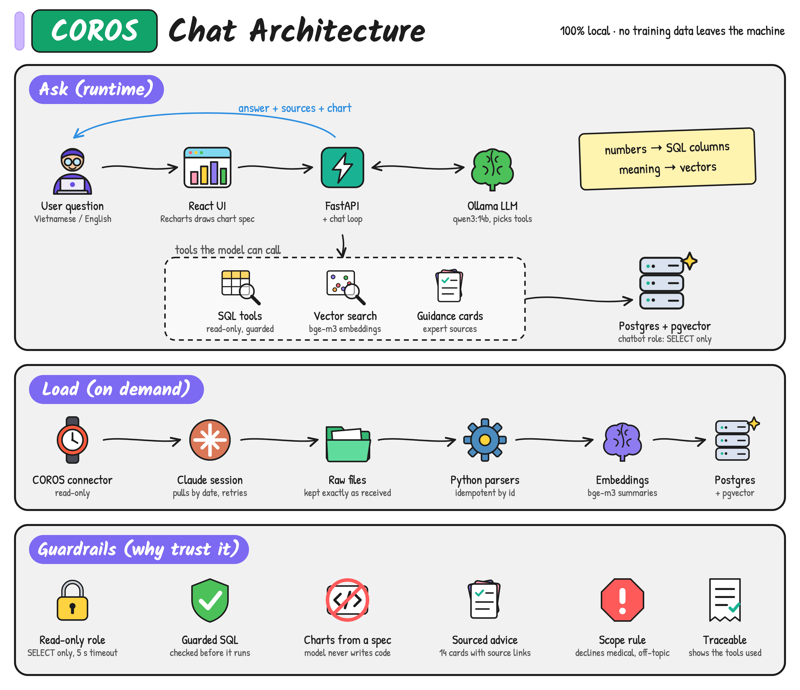

# COROS Chat

A personal, local-only chatbot that answers questions about your own COROS training data, in Vietnamese or English.
It is also a learning project: how a vector database (Postgres + pgvector) fits into an AI chatbot, and the steps of building one.

Ask things like:

- "How many km did I run this week?"
- "Plot my weekly running km for the last month."
- "Is my training load OK, and how should I train next week?"
- "Find my long, slow runs."

Everything runs on your machine: the model (Ollama), the database (Docker), the API and the UI. No training data leaves it.

## How it works



```
React UI  ->  FastAPI  ->  chat loop  ->  Ollama (qwen3:14b, tool calling)
                               |
                               +--> query tools  (read-only Postgres role)
                               +--> vector search (bge-m3 + pgvector)
                               +--> guidance cards (expert sources)
                               +--> draw_chart  (returns a chart spec, UI draws it)
```

- **Hybrid retrieval.** Numbers stay in SQL columns (sport, date, distance). Vectors rank activities by meaning ("easy long run"). Embeddings are English summaries generated from the numbers.
- **Tools, not free text.** The model picks fixed query tools (`recent_activities`, `weekly_totals`, `period_totals`, `daily_load`, `activity_laps`, ...), vector search, or a guarded `run_sql`. Every answer lists the tools it used, so numbers can be traced.
- **Read-only by privilege.** The chatbot connects as `chatbot_ro`: SELECT only, 5 s statement timeout. `src/tools/sql_guard.py` is an extra pre-check, not the real defence. `src/checks/check_readonly.py` proves writes are refused.
- **Guidance with sources.** Training advice comes from 14 paraphrased cards (`src/guidance/cards.json`), each with a source link and a consensus level. The sources footer and the "not medical advice" line are added by code, not left to the model. Diet, medical and off-topic questions are declined.
- **Charts from a spec.** The model never writes plotting code. `draw_chart` takes a guarded SELECT, a kind (`bar` or `line`), columns and titles; the backend validates them against the real rows and the UI draws them with Recharts in the app's theme. Missing weeks and months in bar charts are filled in.

## Requirements

- macOS or Linux, Python 3.12+ (developed on 3.15 with `uv`), Node 20+
- [Ollama](https://ollama.com) with `qwen3:14b` (chat) and `bge-m3` (embeddings); about 11 GB of disk, 24 GB RAM recommended
- Docker (Postgres 17 + pgvector)
- A COROS account and a way to export your data (see "Getting your data")

## Setup

1. Python environment:

   ```sh
   python3 -m venv .venv
   .venv/bin/pip install -r requirements.txt
   ```

2. Models:

   ```sh
   ollama pull qwen3:14b
   ollama pull bge-m3
   ```

3. Database. Pick your own password and keep it out of git:

   ```sh
   docker run -d --name fitness-pg -p 127.0.0.1:5432:5432 \
     -e POSTGRES_PASSWORD=<choose-a-password> -e POSTGRES_DB=<db-name> \
     -v fitness-pgdata:/var/lib/postgresql/data pgvector/pgvector:0.8.7-pg17
   ```

4. Create `.env` in the project root (it is git-ignored). Keys the code reads:

   | Key | Meaning |
   |---|---|
   | `POSTGRES_USER`, `POSTGRES_PASSWORD`, `POSTGRES_DB`, `POSTGRES_PORT`, `POSTGRES_CONTAINER` | Owner connection, used by loaders and `scripts/psql.sh` |
   | `CHATBOT_RO_PASSWORD` | Password for the read-only role `chatbot_ro` |
   | `OLLAMA_URL`, `OLLAMA_EMBED_MODEL` | Ollama address and embedding model |
   | `OLLAMA_CHAT_MODEL`, `OLLAMA_CHAT_MODELS` | Default chat model and the comma-separated list the UI may offer |
   | `TOOL_MAX_ROWS`, `CHART_MAX_ROWS` | Row caps for tool results and charts |
   | `SEARCH_MAX_DISTANCE`, `GUIDANCE_MAX_DISTANCE` | Cosine-distance cut-offs; farther matches are dropped |
   | `CHAT_MAX_TOOL_ROUNDS` | Tool-call rounds allowed per question |

5. Schema and read-only role:

   ```sh
   scripts/psql.sh < sql/001_schema.sql
   scripts/psql.sh -v ro_password="$CHATBOT_RO_PASSWORD" < sql/002_readonly_role.sql
   ```

6. UI dependencies: `cd ui && npm install`

Check everything with `scripts/status.sh` (Ollama, models, container, table counts, venv).

## Getting your data

Data enters through the COROS connector in a Claude session, which saves its output unmodified under `data/raw/` (git-ignored). Python loaders then parse those files into Postgres. Loads are idempotent.

```sh
.venv/bin/python src/ingest/load_sport_records.py data/raw/<sport_records>.json   # activities first
.venv/bin/python src/ingest/load_activity_details.py data/raw/<details>.json
.venv/bin/python src/ingest/load_laps.py data/raw/<laps>.json
.venv/bin/python src/ingest/load_daily_metrics.py <training_load.json> [<resting_hr.json>]
.venv/bin/python src/embed/embed_activities.py
.venv/bin/python src/embed/embed_weeks.py
.venv/bin/python src/guidance/load_cards.py
```

The connector sometimes answers "Tool call anomalies detected" instead of data; retry that call. Details and laps need one call per activity, so they are loaded for recent runs only.

## Run

```sh
.venv/bin/uvicorn --app-dir src/api server:app --host 127.0.0.1 --port 8000
cd ui && npm run dev            # http://127.0.0.1:5173, proxies /api to port 8000
```

Terminal chat without the UI: `.venv/bin/python src/chat/chat.py` (add `--think` for the model's thinking mode).

The API binds to localhost only. Conversations live in memory and vanish on restart.

## Test and evaluate

```sh
.venv/bin/python -m unittest discover -s tests        # parsers, SQL guard, chart checks, DB tools
.venv/bin/python src/checks/check_data.py             # loaded data is consistent
.venv/bin/python src/checks/check_readonly.py         # chatbot role cannot write
.venv/bin/python src/eval/run_eval.py [--only <text>] # ~30 questions, needs Ollama
```

The evaluation set computes its expected values from the database at run time (direct SQL), so it stays correct as data changes. Results go to `data/eval/`. Treat the pass rate with care: the set was tuned on its own questions, so repeat runs and new questions are the real test.

A pre-commit hook (`.githooks/pre-commit`) runs the tests and blocks `.env`, `data/` and `.venv/`, and scans the staged diff for values of secret-named `.env` keys. Enable it with `git config core.hooksPath .githooks`.

## Layout

| Path | What |
|---|---|
| `src/ingest/` | Raw connector files into Postgres |
| `src/embed/` | Summaries, embeddings, exact similarity search |
| `src/tools/` | Query tools and the SQL guard (run as `chatbot_ro`) |
| `src/chat/` | Chat loop, tool specs, system prompt |
| `src/charts/` | `draw_chart` spec builder and validator |
| `src/guidance/` | Expert guidance cards and loader |
| `src/api/` | FastAPI server |
| `src/eval/`, `src/checks/`, `tests/` | Evaluation set, health checks, unit tests |
| `ui/` | React + Vite + Recharts front end |
| `sql/` | Schema and read-only role |
| `docs/` | Spec (`spec.md`), measurements, planning history (`wayfinder/`) |

## Privacy

- The database, `data/` (raw connector output, including start coordinates) and `.env` are never committed.
- Embedding summaries are built from database columns only, without coordinates.
- Nothing here is medical advice. The bot gives guidance from COROS metrics and cited sources, and sends health concerns to a professional.

## Limits and status

- Single user, built around one person's COROS account. Not a general product.
- Not built yet: HNSW index experiment, sleep/stress/VO2max data, persistent conversations, request timeout and question length limits.
- Guidance cards are paraphrases with source links; check the sources before relying on them.

## License

[MIT](LICENSE). Your COROS data is not part of this repository and is not covered by it.

Third-party code: `ui/src/components/ui/ai-prompt-composer-with-model-selector.tsx` is adapted from "AI Prompt Composer with Model Selector" by neeraj singh, published under the MIT License on [21st.dev](https://21st.dev/@hellocloud.webdev/components/ai-prompt-composer-with-model-selector). The attribution is also at the top of the file.
